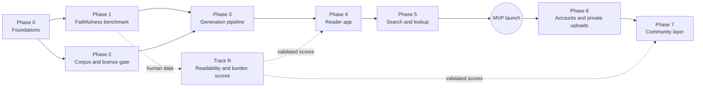

# Plan — ResearchBridge

How the project gets from documents to a working product: what is built first, what depends on
what, and what has to be true before moving on. [decisions.md](decisions.md) is the spec; this file
is the order of work. When they disagree, decisions.md wins and this file gets fixed.

Phases end on **exit criteria, not dates**. This is a solo project, so phases run mostly in sequence;
the places where work can overlap are marked.

---

## Principles that set the order

1. **Faithfulness before features.** The benchmark (§1.4) comes before product code. It picks the
   model, sets the quality bar, and is the one asset an incumbent cannot copy overnight. If LLM
   rewrites cannot pass it, the product shape changes, and it is far cheaper to learn that first.
2. **The licence gate is built before anything that displays a paper.** §1.1 says the licence field
   exists from day one; nothing renders or rewrites a paper that has not been through the gate.
3. **Read-only before accounts, accounts before community.** A useful public reader with LLM
   annotations ships first (§1.3 phase 1). Private uploads (§1.2) and the community layer (§1.3
   phase 2) each add cost and risk, so each waits until the previous step works.
4. **Biomedical first.** The licence-gated corpus is mostly PMC and PLOS, and so is the open
   evaluation data (§1.1 addendum, §1.4). Other fields follow once the core works.
5. **Borrow plumbing, build the core.** Reuse permissive, maintained code for ingestion, anchoring,
   metrics and comments. Build the rewrite, whole-paper annotation, appraisal summary and scores.
   No code is copied in before its licence is recorded (Phase 0).

---

## Phase map

| Phase | Builds | Unblocks | Milestone |
|---|---|---|---|
| 0 | Repo layout, licence inventory, dev environment | Everything | — |
| 1 | §1.4 benchmark and its harness | Model choice, faithfulness gate | **M1: benchmark result** |
| 2 | Django backend, schema, ingestion, licence gate | Any paper being stored or shown | — |
| 3 | Rewrite, annotation and summary pipelines | Content to show | — |
| 4 | Next.js reader, credibility panel | Public reading | — |
| 5 | Search (entry point 1) and lookup (entry point 2) | Discovery | **M2: MVP launch** |
| 6 | Accounts, ORCID, private bring-your-own-PDF | Contributors; paywalled papers | **M3: accounts** |
| 7 | Verify/correct/vote, human annotations, discussion | The moat | **M4: community** |
| R | Readability and prior-knowledge burden scores | Score display; annotation targeting | Ships when validated |

**Overlap allowed:** Phase 2 can start alongside Phase 1 (the benchmark needs a small JATS
ingester anyway, and that code is the seed of Phase 2). Track R runs alongside everything from
Phase 1 onward, because its human data is collected in the same study.

---

## Phase 0 — Foundations

Small, but it keeps later phases from going wrong in expensive ways.

- [ ] Repo layout: `benchmark/` (Python), `backend/` (Django), `web/` (Next.js), `docs/`.
- [ ] `docs/licence-inventory.md`: one row per reused project — code licence, weights licence,
      data/API terms, version pinned, how it is used (linked / vendored / reference only). Seed it
      from the report's licence tiers. Rule from §1.6: permissive only; AGPL is reference-only; GPL
      tools run offline only; check weights separately from code.
- [ ] Two items the report flagged for a recorded licence review before use: the Hypothesis client
      (GitHub reports "NOASSERTION" — BSD-2 plus bundled MIT parts) and PaperCraft (Apache-2.0 in
      npm, no LICENSE file).
- [ ] Python tooling for `benchmark/` and `backend/` (one version, a lockfile, a formatter, tests).
- [ ] Claude API key handling via environment config; model IDs in config, never in code (§1.6).
- [ ] A `CLAUDE.md` / contributor note pointing at decisions.md and this plan.

**Exit:** the repo builds and tests run in CI; the licence inventory exists and is the place every
new dependency gets recorded.

---

## Phase 1 — Faithfulness benchmark (§1.4) → **M1**

The first real work. Everything about the rewrite and LLM annotation depends on its result.

**Material**
- [ ] Pick 12 biomedical/life-science papers across study types (randomised trial, observational,
      lab/mechanistic, review) from the PLOS and eLife lay-summary datasets. Check each against
      §1.1 at its primary source, not the dataset card.
- [ ] Minimal JATS ingester for those 12 (pubmed_parser, MIT): sections → paragraphs with stable IDs.
      Write it so Phase 2 can absorb it.

**Generation**
- [ ] Paragraph-aligned rewrite harness: each rewritten paragraph maps to a source paragraph.
- [ ] Prompt that allows 1–2 sentences of added context but **marks** each addition, so the rubric
      can classify additions instead of forbidding them.
- [ ] Run the candidate model(s) — Claude Sonnet 5.5 as the starting candidate — at temperature 0
      and at default, to test the reported effect on overgeneralisation.
- [ ] Human-written arm: plain-language versions of the same passages by a person, not a model.

**Scoring**
- [ ] Claim decomposition of each rewrite (≈20–30 claims each; ≈250–350 total).
- [ ] Rubric with separate binary codes: supported / unsupported / contradicted; overgeneralisation
      (Peters's three shifts); lost hedge or certainty; correlation→causation; spin; substituted
      number or population; dropped limitation; added information (factual / non-factual).
- [ ] Rater guide with worked examples; recruit ≥2 domain-literate raters; adjudicate; report
      agreement (κ per code).
- [ ] LLM judge: calibrate first on FactPICO (CC BY 4.0) against its expert ratings, then against
      our raters. The judge model differs from the generator.
- [ ] Automatic baselines for comparison: AlignScore or a MiniCheck MIT checkpoint, QAFactEval.
      Not Bespoke-MiniCheck-7B (non-commercial); nothing derived from LLM-AggreFact (no-derivatives).

**Comprehension study (shared with Track R and §1.3)**
- [ ] Lay comprehension questions on the same passages, answered after reading original vs LLM
      rewrite vs human rewrite.
- [ ] Lay readers also mark the terms they do not know — the validation data for the burden score.

**Outputs**
- [ ] Chosen generation model, settings and prompt, recorded as a new decision in decisions.md.
- [ ] A judge-vs-human agreement figure, and the threshold the production gate will use.
- [ ] A short write-up of method and results, suitable for publishing on the site later.

**Exit / decision gate:**
- Rater agreement is reported and acceptable for the binary codes.
- The judge's agreement with humans is known, so we know whether the faithfulness gate can be
  automated or needs human review.
- **If LLM rewrites fail the bar:** record it, and re-scope F1 before Phase 3 — e.g. launch with
  annotations and summaries only, and keep the full rewrite behind the gate until it passes.

---

## Phase 2 — Corpus and licence gate (§1.1, §1.6)

Can start during Phase 1.

**Backend skeleton**
- [ ] Django project, Postgres + pgvector, a background worker on the same codebase.
- [ ] Hosting: one managed platform (Render or Railway) + Cloudflare R2 for source files (§1.6).

**Schema** (get this right first — both §1.1 and §1.3 say retrofitting provenance is the expensive
mistake)
- [ ] `Paper` and `PaperVersion`: identifiers (DOI, PMCID, arXiv ID), metadata, retraction status.
- [ ] Licence per version: licence URI, **which field it came from**, retrieval date, plus
      per-figure/per-table overrides from JATS `<permissions>` (§1.1 addendum).
- [ ] Derived permissions: `can_display`, `can_rewrite`, `output_licence` (CC-BY-SA →
      rewrite published as CC-BY-SA), `non_commercial`.
- [ ] `Section` / `Paragraph` with stable IDs — the alignment unit for rewrite and faithfulness.
- [ ] `Annotation` in W3C shape: TextQuote + TextPosition selectors, `provenance`
      (`llm` / `human` / `llm_edited`), `model`, `prompt_version`, revision history. Votes, reports
      and revisions as separate tables, even though Phase 7 is the first to use them.

**Licence gate**
- [ ] One function that turns a licence record into permissions, with unit tests for every row of
      the §1.1 table including CC-BY-NC-ND and share-alike.
- [ ] Precedence when sources disagree: PMC `license_code` → Europe PMC `license` → JATS
      `ali:license_ref` → arXiv OAI-PMH → bioRxiv API. Prose-only `<license-p>` goes to a manual
      review queue, never auto-approved.
- [ ] `TDM` (author manuscripts) and no-licence arXiv papers are rejected outright.

**Ingestion**
- [ ] PMC via the `pmc-oa-opendata` S3 bucket (JATS + JSON `license_code`, honour `is_retracted`,
      keep data current, acknowledge NLM — the bucket's terms).
- [ ] PLOS JATS (allofplos, MIT).
- [ ] Deferred to after MVP: arXiv (OAI-PMH licence + native HTML) and Docling as the PDF fallback.
- [ ] Seed corpus: a few thousand biomedical papers, chosen to cover common lay searches.

**Exit:** a seed corpus is stored with verified licences; every gate test passes; a paper whose
licence fails the gate cannot be displayed by any code path.

---

## Phase 3 — Generation pipeline

Needs Phase 1's model choice and judge, and Phase 2's corpus.

- [ ] **Rewrite (F1):** paragraph-aligned rewrite with marked additions, run through the
      faithfulness gate from Phase 1; paragraphs that fail are regenerated or held back, never
      silently shown. Only for papers where `can_rewrite` is true.
- [ ] **LLM annotations (F2, §1.3 phase 1):** term and passage extraction → which ones to explain
      (initially the jargon heuristic; later Track R's burden output) → explanation anchored by a
      quoted selector, stored with full provenance and the accuracy disclaimer.
- [ ] **Appraisal summary (F3):** fixed questions over a single-paper index (PaperQA2, Apache-2.0):
      main findings, limitations, COI, funding, sample and effect sizes, causal vs correlational,
      "does the abstract claim more than the results show?" Every field links to its source span.
      Use JATS COI and funding tags where present. rtransparent may be run offline as a validator
      only (GPL/AGPL).
- [ ] Caching, idempotent re-runs keyed on `(paper_version, model, prompt_version)`.
- [ ] Cost and token tracking per paper; a hard budget per on-demand request.
- [ ] Spot-check sample: a fixed fraction of generated output goes to periodic human review using the
      Phase 1 rubric.

**Exit:** the seed corpus has rewrites, annotations and summaries; faithfulness gate pass rate and
cost per paper are known.

---

## Phase 4 — Reader app

- [ ] Next.js app, server-rendered paper pages (indexable — the main way people will arrive).
- [ ] **Plain-English view** (default for `can_rewrite` papers) with a toggle to **original +
      annotations** — and a side-by-side mode on wide screens, following the alignment.
- [ ] Annotation rendering with `@recogito/text-annotator` (BSD-3) over HTML from JATS.
- [ ] Summary panel with links into the source spans.
- [ ] Credibility panel, paper-level and neutral only (§2.3 deferred): citations and trend,
      field percentile, recency, retraction / expression-of-concern status — all with an "as of"
      date. OpenAlex (via pyalex, MIT), iCite, Crossref/Retraction Watch. No journal-level signals.
- [ ] Attribution and licence display on every paper page and on every rewrite (a UI requirement,
      §1.1). Disclaimers on LLM output (§1.3).
- [ ] "Read original paper" → DOI link; "Find on Google Scholar" → Scholar search URL (§1.5).
- [ ] A methodology page publishing the Phase 1 result.
- [ ] Accessibility and mobile layout — the audience is general public.

**Exit:** any seed-corpus paper can be read end to end in the browser; licence/attribution shown
everywhere it must be.

---

## Phase 5 — Search and lookup → **M2: MVP launch**

- [ ] **Entry point 1, search:** OpenAlex metadata search with filters and sort by date; Postgres
      full-text search over the corpus; each result tagged *plain-English available* / *original +
      annotations only* / *original elsewhere*.
- [ ] **Entry point 2, lookup:** DOI / title / author / PMCID / arXiv ID → corpus hit, or on-demand
      ingest + generation for licence-eligible papers (queued, with a "being prepared" state), or a
      clear "not available here" with the DOI link. Upload is offered only once Phase 6 ships.
- [ ] Rate limits and per-day generation budget so on-demand generation cannot run up cost.
- [ ] OpenAlex cost control: free single lookups by DOI, cached; paid search calls metered (§1.6).
- [ ] Basic analytics (privacy-respecting) to measure reading, not just visits.
- [ ] Launch checklist: licence audit on a random corpus sample, attribution check, disclaimer copy,
      takedown/contact route, terms and privacy pages.

**Exit (M2):** public, read-only, no accounts. Someone can search, open a paper, and read it in plain
English with annotations, summary and neutral credibility signals.

---

## Phase 6 — Accounts and private uploads (§1.2) → **M3**

- [ ] Email sign-in + **ORCID** sign-in (§1.6).
- [ ] Private library per user.
- [ ] Bring-your-own-PDF: upload → Docling (MIT; Apache-2.0 models) → private rewrite, annotations
      and summary for that user only. Never written to the shared annotation store; never indexed;
      deletable; LLM calls with no-training / minimal-retention settings.
- [ ] If an uploaded paper is in the corpus, redirect to the shared version.
- [ ] **Gate:** the legal opinion required by §1.2. The feature can be built behind a flag; it is
      not opened to the public until the opinion is in.

**Exit (M3):** accounts work; private uploads work end to end behind the flag; legal opinion
requested or received.

---

## Phase 7 — Community layer (§1.3 phase 2) → **M4**

Start when there are readers to recruit from. Set the trigger at M2 using the analytics (e.g. a
level of returning weekly readers), and record it in decisions.md.

- [ ] **Verify / correct / vote** on existing LLM annotations; corrected ones become `llm_edited`.
- [ ] Human-written annotations on any passage.
- [ ] Provenance filter in the reader (human / LLM / both); human-verified shown by default; LLM
      drafts kept, never deleted.
- [ ] Revision history and diff for each annotation.
- [ ] Moderation: report queue and actions in Django admin; pre-moderation for new accounts.
- [ ] Reputation and ORCID-verified badges. ResearchHub's backend (MIT) is the reference for votes
      and reputation — check its coupling to its token economy before borrowing.
- [ ] **Per-paper discussion (F5):** whole-document annotations sharing the same data model and
      moderation queue, or Remark42 (MIT) if that proves simpler.
- [ ] Seeding: a small set of featured papers verified by recruited domain experts (the
      Fermat's Library pattern) before opening writes to everyone.
- [ ] Re-run the Phase 1 comparison with real community output: human-verified vs LLM-only, on
      faithfulness and comprehension.

**Exit (M4):** community contributions are live with moderation; the human-verified share of
annotations is measured and growing.

---

## Track R — Readability and prior-knowledge burden scores (§2.4)

Runs alongside the phases from Phase 1 on. Nothing is displayed until it is validated.

- [ ] Readability features: sentence length, syntactic depth, nominalisation density, passive rate,
      jargon density.
- [ ] Validation 1: PLOS/eLife pairs — the lay summary should score easier in nearly every pair.
- [ ] Validation 2: agreement with lay readers' pairwise "which is harder?" judgements.
- [ ] Burden pipeline: term extraction (shared with Phase 3 annotation targeting) → remove terms the
      paper defines → weight by unfamiliarity (word frequency from an open corpus; a
      reimplementation, since De-Jargonizer has no code licence) → per 1,000 words.
- [ ] Validation: against the "terms I don't know" marks from Phase 1's lay readers.
- [ ] Ask MedReadMe's authors before using their data (no licence); PersonalizedJargon is
      Apache-2.0.
- [ ] Record final definitions in decisions.md, superseding the §2.4 drafts.

**Exit:** both scores validated and recorded; they then ship in the reader (Phase 4 panel) and feed
annotation targeting (Phase 3).

---

## Later — not scheduled

| Item | Trigger or prerequisite |
|---|---|
| Journal-level credibility signals (§2.3) | Decide before showing **any** signal about a journal; legal review for negative labels |
| arXiv ingestion (non-biomedical) | After MVP; plus a second benchmark round in that field |
| Browser extension (paywalled papers, §1.2) | After M3; follows the Hypothesis model |
| Sharing annotations of uploaded paywalled papers | Only if the §1.2 legal opinion allows it |
| Business model | Before any paid feature; NC-licensed papers constrain it (§1.1). The report found no paying lay market, which points to grants or a nonprofit model |
| Native app | Not planned (§1.5) |

---

## Decisions this plan will produce

Each gets recorded in decisions.md as it is made:

- Generation model, settings and prompt — **end of Phase 1**.
- Faithfulness gate threshold and whether it needs human review — **end of Phase 1**.
- Readability and burden score definitions — **end of Track R**.
- Community-launch trigger metric — **at M2**.
- Bring-your-own-PDF go-live — **when the legal opinion arrives**.
